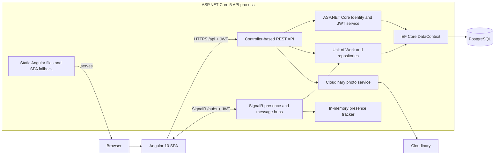

# Current Architecture

This document describes the repository at `master` commit `9abaa2588b0c23b6c25eac181069a007d79278d1`, inspected on 2026-08-24. It is descriptive, not a future-state design.

## System view

## Components and responsibilities

| Component | Responsibility | Evidence |
| --- | --- | --- |
| Angular SPA | Registration/login UI, member profiles and discovery, likes, messages, presence, photo/profile editing, administration, and sandbox pages. | `client/src/app`, `client/src/environments` |
| ASP.NET Core host | Starts the process, migrates and seeds the database, configures middleware, serves the compiled SPA, and maps controllers and hubs. | `API/Program.cs`, `API/Startup.cs`, `API/wwwroot` |
| Controllers | Expose attribute-routed JSON endpoints for accounts, users, likes, messages, administration, countries/cities, and sample errors. | `API/Controllers` |
| SignalR hubs | Track presence and handle real-time message threads, delivery, and read state. | `API/SiganlR` (directory name in repository), `Startup.cs` |
| Services | Create JWTs and upload/delete photos through Cloudinary. | `API/Services` |
| Unit of Work and repositories | Query and mutate users, likes, messages, photos, countries, and cities using a shared `DataContext`. | `API/Interfaces`, `API/Data` |
| EF Core/Identity model | Persists users/roles plus social, messaging, connection, country, and city data in PostgreSQL. | `API/Entities`, `API/Data/DataContext.cs`, migrations |
| Presence tracker | Keeps online usernames and connection IDs in process memory. | `API/SiganlR/PresenceTracker.cs` |

## Dependency direction

The Angular client calls HTTP controllers and SignalR hubs. Controllers mostly depend on repository interfaces through `IUnitOfWork`, ASP.NET Core Identity managers, mapping, and photo/token services. `UnitOfWork` constructs concrete repositories over one EF Core `DataContext`. Identity and the repositories persist to the same PostgreSQL database. The photo service alone calls Cloudinary.

Business behavior is distributed across controllers, hubs, repositories, Identity calls, and Angular components/services. There is no separate application or domain project, and the entity model is coupled to ASP.NET Core Identity and EF Core persistence conventions.

## Main flows

1. **Startup:** `Program` builds the host, applies EF Core migrations, seeds roles/users and countries when needed, logs migration exceptions, and then starts the host.
2. **SPA delivery:** the Angular production build writes into `API/wwwroot`; static-file middleware and `FallbackController` serve the SPA from the API process.
3. **Account:** Angular posts registration/login data to `AccountController`; ASP.NET Core Identity uses `DataContext`, and `TokenService` returns a signed JWT.
4. **Authenticated REST:** an Angular interceptor attaches the bearer token; controllers read identity claims and use the unit of work/repositories; pagination metadata is returned in a response header.
5. **Messaging and presence:** Angular opens authenticated SignalR connections. Hubs use the in-memory presence tracker and persist messages, groups, and connections through the unit of work.
6. **Photos:** the API streams an uploaded file to Cloudinary and stores the returned URL/public identifier in PostgreSQL; role-protected admin endpoints moderate photo records.

## Persistence and configuration

- EF Core uses the Npgsql provider and PostgreSQL in both configured paths.
- Development reads `ConnectionStrings:BookShare` from configuration.
- Non-development code parses a Heroku-style `DATABASE_URL` environment variable.
- Migrations are stored in `API/Data/Migrations` and are applied automatically at process startup.
- The same database contains ASP.NET Core Identity tables and application tables.
- Presence is process-local memory, while SignalR message groups/connections are represented in the database.

## Authentication and cross-cutting behavior

- ASP.NET Core Identity manages users, passwords, and roles (`Member`, `Admin`, `Moderator`).
- JWT bearer authentication protects most user controllers and the presence hub; role policies protect admin/photo-moderation endpoints.
- Custom middleware handles unhandled exceptions.
- `LogUserActivity` updates authenticated users' last-active timestamp after controller actions.
- AutoMapper maps entities to DTOs; custom pagination types and headers support list endpoints.
- CORS permits the local Angular development origin with credentials.
- Swagger generation is registered, but Swagger middleware/UI is not mapped in `Startup`.

## External dependencies

- PostgreSQL is the relational store.
- Cloudinary stores user photos.
- Production database configuration assumes Heroku's `DATABASE_URL` format; no complete deployment definition is present in the repository.
